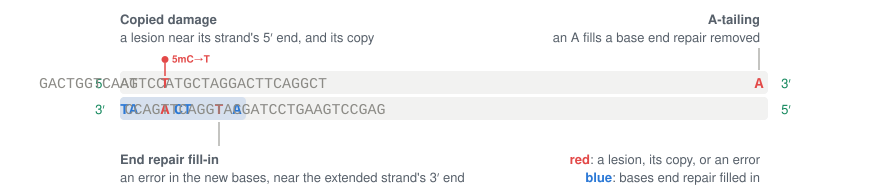
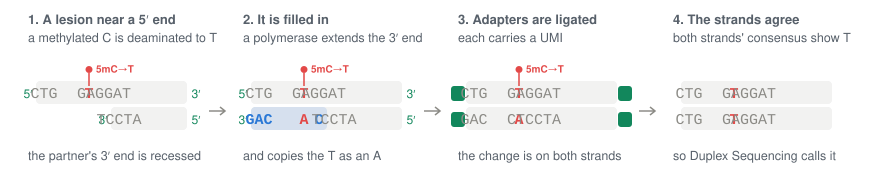
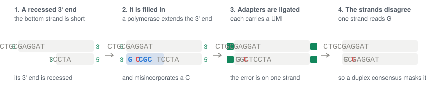
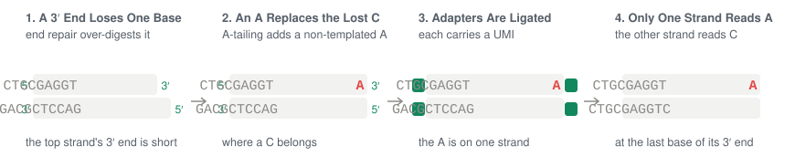
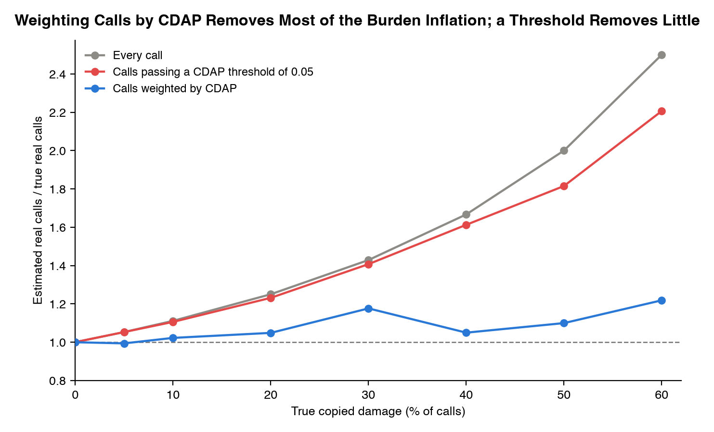

# chaff

[](http://bioconda.github.io/recipes/chaff/README.html)
[](http://bioconda.github.io/recipes/chaff/README.html)
[](https://github.com/clintval/chaff/actions/workflows/ci.yml?query=branch%3Amain)
[](https://coveralls.io/github/clintval/chaff?branch=main)
[](LICENSE)
[](https://www.rust-lang.org/)

Flag somatic variant calls that are library-preparation artifacts.

Install with mamba, conda, or run directly with pixi:

```bash
pixi exec \
    -c conda-forge -c bioconda \
    chaff --help
```

## Quick Start

The `chaff` tool needs a VCF of somatic calls, the BAM they were called from, and a reference FASTA with a `.fai` index.
The examples below run from a clone of this repository on the test data from fgbio's `FilterSomaticVcf` [[6]](#references), which are plain read pairs, not a duplex consensus BAM.

*Copied damage* is a damaged base that a polymerase copied onto the partner strand before the UMI adapters were ligated, so both strands carry the change.
To score calls for copied damage and filter the likely artifacts:

```console
chaff \
    --input tests/data/calls.vcf \
    --bam tests/data/tumor.bam \
    --ref tests/data/ref.fa \
    --sample tumor \
    --filters copied-damage \
    --copied-damage-threshold 0.05 \
    --metrics tumor.chaff.tsv \
    --output calls.chaff.vcf.gz
```

The annotated calls are written to `calls.chaff.vcf.gz`, with likely copied damage filtered, and the per-sample metrics to `tumor.chaff.tsv`:

```console
gzip -dc calls.chaff.vcf.gz | grep -v '^#' | cut -f 2,4,5,7,8 | column -t
```

```text
100  C    A  CopiedDamageArtifact  CDAP=0.022;CDLR=1.577;CDAC=3,3;CDRC=72,240
200  G    A  .                     CDAP=1;CDLR=-4.55;CDAC=6,20;CDRC=72,240
300  AAA  A  .                     .
400  A    T  .                     .
500  C    G  .                     .
```

The `CDAP` field is the posterior probability that a call is a real mutation and not copied damage.
It depends on where the call's molecules fall on their fragments and on how common the artifact is in the sample.
A low value means likely copied damage.

A *molecule* is one DNA fragment, counted once no matter how many reads cover it.
Copied damage treats the C>A call at position 100 as an oxidized G on the reverse strand.
All 3 of its alternate molecules are within 23 bp of that strand's 5′ end (`CDAC=3,3`), compared with 72 of its 240 reference molecules (`CDRC=72,240`).
Its `CDAP` of 0.022 is below the 0.05 threshold, so it is filtered.

## Choosing Filters

What each filter can detect depends on the BAM, because a consensus removes artifacts carried by only one strand:

| Data&nbsp;&nbsp;&nbsp;&nbsp;&nbsp;&nbsp;&nbsp;&nbsp;&nbsp;&nbsp;&nbsp;&nbsp;&nbsp;&nbsp;&nbsp;&nbsp;&nbsp;&nbsp;&nbsp;&nbsp;&nbsp;&nbsp;&nbsp;&nbsp; | Run | What each detects |
| --- | --- | --- |
| Reads | All three | Copied damage: lesions in its damage classes near the lesion strand's 5′ end, whether or not they were copied to the partner strand. End repair fill-in: bases misincorporated while a polymerase filled in a recessed 3′ end. A-tailing: a non-templated A at the last base of a 3′ end. |
| Simplex consensus | All three | Same as reads. A simplex consensus collapses the reads of one strand, so single-strand artifacts survive it. |
| Duplex consensus | Copied damage, and end repair fill-in as a fragment-end filter | Copied damage: lesions copied onto both strands before adapter ligation, which a duplex consensus keeps. This is the main filter for Duplex Sequencing. End repair fill-in: any substitution that both strands agree on and that clusters near either fragment end. A-tailing: nothing, unless trimming left the A-tail in place (see the note under [A-Tailing](#a-tailing)). |
| Transposase (tagmentation) library, reads or consensus | Tagmentation, and copied damage | Tagmentation: substitutions at fixed positions from a fragment end, most often the first base, that the library makes more often than its own background and the transposase's base preference predict. Both strands can carry them, so a duplex consensus keeps them. End repair fill-in and A-tailing do not apply, since the library has neither step. |

A CODEC consensus [[9]](#references) from fgbio's `CallCodecConsensusReads` or `fgumi codec` [[10]](#references) has one unpaired record per molecule with duplex tags.
It is treated as a duplex consensus whose template ends are the record's outermost bases.
Each of its strands comes from a single raw read, below the minimum of 2 needed for the single-strand rate, so the prior is learned from the calls, as for a BAM without single-strand tags.

By default every filter runs and only annotates calls.
A filter applies its FILTER only once it has a threshold (see [Setting Thresholds](#setting-thresholds)).
The tagmentation filter learns from the BAM whether the library has its artifact, and scores no call when it does not, so it is safe to leave on for a ligation library.

## Pooled Samples

Some workflows call many samples into one multi-sample VCF from a single BAM that holds every sample's molecules.
Artifacts come from the library, not the sample, and one sample may have only one or two molecules at a site, which is too few to score.
With `--pooled`, each SNV is scored once against every molecule in the BAM, as one sample.

In a pooled run each SNV is scored as heterozygous for REF and its first alternate allele, regardless of genotype.
Sample columns are written back unchanged, and INFO annotations and FILTERs are added as usual.
The metrics and spectrum label the sample `pooled`.
A VCF without samples, such as a sites-only VCF, is always scored this way.
The `--pooled` option cannot be combined with `--sample`.

This example scores the two samples of the test VCF as one pool, keeping the `normal` column's `0/0` and the `tumor` column's `0/1`:

```console
chaff \
    --input tests/data/calls.vcf \
    --bam tests/data/tumor.bam \
    --ref tests/data/ref.fa \
    --pooled \
    --copied-damage-threshold 0.05 \
    --metrics pooled.chaff.tsv \
    --output calls.pooled.vcf.gz
gzip -dc calls.pooled.vcf.gz | grep -v '^#' | cut -f 2,4,5,7,10,11 | column -t
```

```text
100  C    A  CopiedDamageArtifact  0/1  0/0
200  G    A  .                     0/1  0/0
300  AAA  A  .                     0/1  0/0
400  A    T  .                     0/1  0/0
500  C    G  .                     0/1  0/0
```

## Background

A *template* is one DNA fragment, represented by its two mates (reads or consensus reads), and counts as one molecule.
Its *template ends* are its outermost bases, the 5′ ends of its two strands.
A *lesion* is a damaged base on one strand that a polymerase copies as a different base:

- 5-methylcytosine deaminates to thymine, so a methylated CpG reads as C>T.
- Cytosine deaminates to uracil, so any C can read as C>T. Pfu-family proofreading polymerases stall at template uracil and often leave it uncopied, so after PCR with one of them most surviving deamination is 5-methylcytosine at CpG. The copied damage filter learns separate rates for CpG and other contexts.
- Guanine oxidizes to 8-oxoguanine, which pairs with A, so a G reads as G>T, or C>A on the other strand.

Duplex Sequencing [[2]](#references) ligates UMI adapters to both ends of each fragment, builds a single-strand consensus for each strand, and calls each duplex consensus base from the two.
When the strands agree, the base gets their summed quality.
When they disagree, fgbio's `CallDuplexConsensusReads` and `fgumi duplex` keep the higher-quality strand's base with the difference of the two qualities, or an `N` on a tie [[7]](#references).

The consensus filters, fgbio's `FilterConsensusReads` and `fgumi filter`, mask every base the strands disagree on only with `--require-single-strand-agreement`, which is off by default [[8]](#references).
Without it, only the minimum base quality masks such a base, so it survives whenever one strand's quality exceeds the other's by at least that minimum, as when a strand of many reads disagrees with a strand of one read.
Turn the option on when building a BAM for `chaff`.

With it off, a change on only one strand can survive as an alternate molecule whose quality is the gap between the strands.
The tool drops these below `--min-base-quality` (default 20) and counts the rest as ordinary alternate molecules.
An uncopied lesion near its strand's 5′ end then looks like copied damage and is counted as such in `CDAC`, the metrics, and the spectrum.

With it on, a duplex consensus removes every single-strand error, including uncopied lesions, but not damage copied onto both strands before adapter ligation.
That copying happens during end repair.
The polymerase extends each recessed 3′ end across the opposite 5′ overhang, and from nicks where it displaces strands, copying any lesion it passes onto the new strand.
The change then appears on both strands, like a real mutation.

## The Filters

Each filter compares where a call's alternate molecules are on their templates with where its reference molecules are.
It then writes the posterior probability that the call is real, given the sample's *artifact fraction*: the share of the sample's calls that are artifacts, learned from all of them.
Under `--model fgbio`, which exists to reproduce fgbio's values, each call's artifact fraction comes from its own alternate allele fraction instead.
A low posterior means a likely artifact, and a threshold filters calls at or below it.

Each filter models one library-preparation step that leaves an artifact near a known end of the fragment:



Fill-in length varies between fragments, so the evidence for copied damage and end repair fill-in falls off with distance from the end.
Both filters model this as an exponential *decay* whose *scale*, the mean fill-in length, is learned per sample.
A-tailing changes only the last base of a 3′ end and is scored within a 2 bp window.

The filters score SNVs with a heterozygous or missing genotype (many somatic callers leave it missing), and every SNV in a [pooled run](#pooled-samples).
Indels pass unscored, as do homozygous and haploid calls outside a pooled run, because the filters compare alternate molecules with the sample's reference molecules at the site.
Copied damage scores SNVs in its damage classes on either strand: C>T covers C>T and G>A calls, and G>T covers G>T and C>A calls.
A-tailing scores SNVs whose alternate base is A or T, and end repair fill-in scores all SNVs.

If the sample does not carry REF, for example at a site homozygous for another germline allele, each filter scores the call from the base the sample does carry.
A G>T call in a sample homozygous for C is scored as a C>T.
If the sample carries REF and another base, the call is scored from both, each weighted by its molecules and its artifact rate.
A base other than REF or a called alternate counts as carried when it is on at least 10 molecules and on more than 2% of the molecules without a called alternate.
REF on 2 or fewer molecules is treated as a stray.
The `PA` INFO field lists the bases a call was scored from.

### Copied Damage



Copied damage puts the change on both strands, so a duplex consensus keeps it.
A library prep can prevent it by fragmenting with a restriction enzyme that leaves blunt ends, as NanoSeq does [[3]](#references), or by repairing lesions before end repair, as Duplex-Repair does [[4]](#references).

- **Measured from:** the 5′ end of the *lesion strand*, the strand that carries the damaged base.
- **Scored with:** a decay with a scale learned per sample, starting from 30 bp.
- **Writes:** the posterior `CDAP`, the likelihood ratio `CDLR`, the molecule counts `CDAC` and `CDRC`, and the FILTER `CopiedDamageArtifact`.
- **Use it when:** UMI adapters are ligated after a polymerase fills in ends, nicks, or gaps, as in Duplex Sequencing. Requires `--ref`.

Fill-in runs from the partner's recessed 3′ end toward the lesion strand's 5′ end, so copied lesions cluster near that end.
A real mutation's molecules are spread the same way as the reference molecules.
On reads or a simplex consensus, uncopied lesions are visible too.
Deamination among them is concentrated at the same 5′ ends, where the overhangs were single-stranded [[1]](#references), so the filter flags those as well.

Lesions copied from an internal nick, by nick translation or strand displacement, or across the gap left by an abasic site, can be anywhere in the template.
Their position carries no end signal, so they show up only as an excess of the damage class across the library.

A duplex consensus BAM with each strand's single-strand consensus, in the `ac`, `bc`, `ad`, and `bd` tags that fgbio and fgumi write, addresses this.
With those tags the tool makes a second pass over every molecule, counting duplex changes and *single-strand* changes (uncopied lesions on one strand) per damage class and context.
A molecule counts toward the single-strand rate only if at least 2 raw reads agree with each strand's base.
Agreeing reads are the `ad` or `bd` depth minus the `ae` or `be` errors, or the depth alone if the error tags are missing.

Copied lesions hit a position one molecule at a time, while a clonal mutation puts several molecules at one position.
So for a call with two or more alternate molecules, the prior artifact fraction becomes the share of library positions of the same depth, with as many changes, that chance alone explains.
The learned fraction is used instead with `--copied-damage-prior learned`, or when the call looks germline (alternate in at least 20% of its molecules).

The chance prior has two weaknesses.
Two independent real mutations at one position also look like chance, so when real single-molecule mutations occur at a tenth of the damage rate or more, the chance prior filters some real calls with two molecules.
A position damaged far more than the rest of its class appears real under the chance prior, so a threshold there depends on the decay alone.
Without the single-strand tags, the artifact fraction is learned from the calls.

### End Repair Fill-In



On reads or a simplex consensus, this filter flags bases a polymerase misincorporated while filling in a recessed 3′ end.
These errors are on the extended strand, near its 3′ end.
A lesion copied from the overhang is there too, and that is copied damage, so a call near an end can be flagged by both filters, like the call at position 100 in [3. Set and Check](#3-set-and-check).

A duplex consensus has already removed misincorporations, since each is on one strand.
There the filter flags any substitution both strands agree on that clusters near either fragment end.
That includes copied damage of any chemistry and anything else concentrated at fragment ends, but not fill-in errors.

- **Measured from:** the 3′ end of the read 1 strand, which end repair extended. That is the higher-coordinate end of an F1R2 pair, whose read 1 is forward, and the lower-coordinate end of an F2R1 pair. On a duplex consensus, recognized by fgbio's `aD` and `bD` per-strand depth tags, it is the nearer template end, since the change can be at either strand's end.
- **Scored with:** a decay with a scale learned per sample, starting from 15 bp, or 5 bp on a duplex consensus, where the changes are within a few bases of the end.
- **Writes:** the posterior `ERFAP` and the FILTER `EndRepairFillInArtifact`.
- **Use it when:** a polymerase end-repaired the library before adapter ligation, as in most ligation preps after mechanical or enzymatic fragmentation. On a duplex consensus, use it when calls cluster at fragment ends.

Copied damage and end repair fill-in both look at the bases end repair filled in, from opposite strands:

| &nbsp;&nbsp;&nbsp;&nbsp;&nbsp;&nbsp;&nbsp;&nbsp;&nbsp;&nbsp;&nbsp;&nbsp;&nbsp;&nbsp;&nbsp;&nbsp;&nbsp;&nbsp;&nbsp;&nbsp;&nbsp;&nbsp;&nbsp;&nbsp;&nbsp;&nbsp;&nbsp;&nbsp;&nbsp;&nbsp;&nbsp;&nbsp;&nbsp;&nbsp;&nbsp;&nbsp;&nbsp;&nbsp;&nbsp;&nbsp; | Copied Damage | End Repair Fill-In |
| --- | --- | --- |
| Source of the wrong base | A damaged template base that the polymerase copies | A base the polymerase misincorporates during fill-in |
| Strand at fault | The lesion strand; the copy is on its partner | The extended strand |
| Strands that carry it | Both, once copied | One |
| Duplex consensus | Keeps it | Removes it |
| Classes scored | C>T and G>T, on either strand | Any substitution |
| Measured from | The lesion strand's 5′ end | The extended strand's 3′ end, or the nearer end of a duplex consensus |
| Decay scale | Learned, from 30 bp | Learned, from 15 bp, or 5 bp on a duplex consensus |

On a duplex consensus, use this filter instead of a variant caller's filter on the mean distance from a call to the nearest read end.
Once overlapping mates are clipped, each clip point in the middle of a fragment is also a read end, so a read-end filter also flags real calls whose few alternate molecules happen to be near one.
The file `tests/data/duplex.bam` holds the example reads as a duplex consensus with those depth tags:

```console
chaff \
    --input tests/data/calls.vcf \
    --bam tests/data/duplex.bam \
    --sample tumor \
    --filters end-repair-fill-in \
    --end-repair-fill-in-threshold 0.05 \
    --output calls.duplex.vcf.gz
gzip -dc calls.duplex.vcf.gz | grep -v '^#' | cut -f 2,4,5,7,8 | column -t
```

```text
100  C    A  EndRepairFillInArtifact  ERFAP=0.001182
200  G    A  .                        ERFAP=1
300  AAA  A  .                        .
400  A    T  EndRepairFillInArtifact  ERFAP=0.00002302
500  C    G  EndRepairFillInArtifact  ERFAP=0.00002302
```

The learned scale is 3.75 bp, and every call whose alternate molecules are within 3 bases of a template end is filtered.
That includes the A>T at position 400 and the C>G at position 500.
Their molecules are at the 5′ end of the read 1 strand, where end repair adds no bases, so they pass on the read pairs in [3. Set and Check](#3-set-and-check).

### A-Tailing



A-tailing adds a non-templated A to each 3′ end so that adapters with a T overhang can be ligated.
If end repair over-digested a 3′ end by one base, the A replaces the lost base on that strand only, so a duplex consensus usually removes it.
On the forward strand it reads as an A near the template's higher-coordinate end, and on the reverse strand as a T near the lower-coordinate end.

- **Measured from:** the template end where the added A appears, the lower-coordinate end for a T and the higher-coordinate end for an A.
- **Scored with:** a 2 bp window, as in fgbio.
- **Writes:** the posterior `ATAP` and the FILTER `ATailingArtifact`.
- **Use it when:** the library was A-tailed for T-overhang adapters, unlike blunt-end ligation or transposase (tagmentation) preps, and the BAM is not a duplex consensus.

> [!NOTE]
> If read trimming leaves the A-tail in place, the non-templated A can appear on both strands and survive a duplex consensus, at the last base of a 3′ end.
> Before dropping A-tailing for a Duplex Sequencing library, measure it as in [2. Measure](#2-measure). A small `asymmetry_p_value` in its metrics rows means the library has the artifact.

### Tagmentation

A transposase cuts a fragment and joins its adapters in one step, then a polymerase fills a short gap at each fragment end.
The bases at fixed positions from a fragment end, most often the first, can then read as another base more often than the bases inside the fragment.
The change can be on both strands, so a duplex consensus keeps it.
Which positions and which substitutions differ between chemistries, so the filter learns them from the library and has no built-in position.

- **Measured from:** both template ends, each read in its own orientation.
- **Scored with:** the positions and substitutions learned from the BAM, written in the `TGAP` header line as, for example, `T>G@1`.
- **Writes:** the posterior `TGAP`, the likelihood ratio `TGLR`, the molecule counts `TGAC` and `TGRC`, and the FILTER `TagmentationArtifact`.
- **Use it when:** the library was made by tagmentation. It needs `--ref` and `--model chaff`.

The filter reads every record of the BAM once and counts, at each of the first 20 bases from the record's 5′ end, the reference base against the base read.
Three things keep it from flagging real variants:

- **Base preference.** A transposase prefers some bases at each position near its cut, and it reads the sample's base, not the reference's. A real allele is therefore found at a position more often than the reference base it replaces, by the ratio of the two bases' shares there. The filter measures that ratio from the reference bases at each position and expects that many more real alleles, so only a rate beyond it counts as an excess.
- **Shared sites.** A substitution counts once per site, so a germline allele that many molecules share weighs what one molecule's error does.
- **CpG context.** A C>T at a CpG is far more common than elsewhere, so C>T and G>A are learned separately inside and outside a CpG.

A position is learned for a substitution when it has at least 50 substitutions, at 1.5 times the expected rate or more, and well beyond chance.
A call is then scored by where its alternate molecules are.
Alternate molecules at a learned position favor the artifact, and one alternate molecule anywhere else outweighs them.
A call with no alternate molecule at a learned position always gets a `TGAP` of 1, whatever the prior, so the prior alone never flags a call.
A call of a substitution with no learned position gets no `TG` fields.

A BAM with few records, as a duplex consensus often is, may not have the 50 substitutions a position needs.
It can borrow the profile of a larger BAM of the same library, such as its single-strand consensus:

```bash
chaff --input calls.vcf.gz --bam simplex.bam --ref ref.fa --output simplex.chaff.vcf.gz \
    --tagmentation-profile-output library.tagmentation.tsv
chaff --input duplex.calls.vcf.gz --bam duplex.bam --ref ref.fa --output duplex.chaff.vcf.gz \
    --tagmentation-profile library.tagmentation.tsv
```

A borrowed profile assumes the two BAMs share the artifact, which a duplex consensus may carry at a lower rate than its single-strand consensus.

## Setting Thresholds

Every filter runs by default but only annotates calls until it has a threshold, so choosing a filter means setting its threshold.
Start from each filter's **Use it when** line, then check the data.
Set a threshold when somatic calls show an excess of C>T or C>A with few supporting molecules, when their alternate bases cluster at one fragment end, or when the filter's metrics show a small asymmetry p-value.
Expect copied damage in old, stored, or degraded specimens, and when C>T at CpG exceeds what the matched normal or the clock-like signature SBS1 predicts.

### 1. Look

Profile the raw reads before consensus with the `error` tool of [Riker](https://github.com/fulcrumgenomics/riker):

```bash
riker error -i raw.bam -r ref.fa -o raw --stratify-by ref_base,read_base,read_num,cycle
```

The output `raw.error-mismatch.txt` gives each substitution's `frac_error` by read number and cycle, in sequencing orientation.
For example, the row `C,T,R1,1` is read 1's C>T rate at cycle 1.

A C>T rate that rises toward cycle 1 is deamination in single-stranded 5′ overhangs [[1]](#references), the lesions end repair copies.
A C>A excess on one read number but not the other is 8-oxoguanine, the read-orientation bias that GATK's `LearnReadOrientationModel` [[5]](#references) models.
An A or T excess at read ends is A-tailing.
How far an excess extends from read starts is a rough check on the decay scales the tool learns.

Damage copied onto both strands before adapter ligation looks the same on both strands, so no strand or read-number metric can separate it from a real variant.
Only the next step can detect it.

### 2. Measure

Run the filters without thresholds so they only annotate, and write the metrics and spectrum.
Each stratum's artifact fraction is learned from every scored call regardless of its FILTER, so first remove the calls your caller rejected:

```console
chaff \
    --input tests/data/calls.vcf \
    --bam tests/data/tumor.bam \
    --ref tests/data/ref.fa \
    --sample tumor \
    --output calls.annotated.vcf.gz \
    --metrics tumor.chaff.tsv \
    --spectrum tumor.spectrum.pdf
```

In the spectrum, compare the expected real SNVs with all SNVs.
Copied damage shows up as C>T at CpG, or C>A, that shrinks after weighting while the other channels keep their height.

Each metrics row covers one filter and *stratum*, a group of calls that share an artifact rate.
For copied damage a stratum is a damage class and CpG context, for tagmentation a substitution with the CpG context of a C>T, and for the other filters a substitution.
Every stratum a filter can score gets a row, with zero counts if it has no calls, so tables from different samples line up.
The columns are:

- **Calls:** the `calls` scored and the calls `filtered`.
- **Fractions:** the `artifact_fraction` is the stratum's learned share of artifacts. It stays near the filter-wide `filter_artifact_fraction` until the stratum has many calls. Both are empty under `--model fgbio`, whose prior is per call, and when no call has a posterior to learn from. The `expected_artifacts` and `expected_mutations` columns sum each call's probability of being an artifact or a real mutation, and a call without a posterior counts as real.
- **Distance:** the `distance` is the decay scale or window in bases, shared by all of a filter's strata. It is empty when the scale is learned and the filter has no call to learn it from.
- **Molecules:** the `alt_molecules` and `ref_molecules` measured, and their `_congruent` counts and fractions, the molecules within `distance` of the artifact's end.
- **Asymmetry:** the `expected_alt_congruent` count is the alternate molecules expected within `distance` from each call's reference molecules, and `asymmetry_p_value` is a one-sided test for more than that. A small value means the library has the artifact.
- **Learned positions:** for tagmentation, `learned_positions` lists the substitutions and positions learned for the stratum, each substitution as a read from that end shows it. The `distance` column is empty, and congruent molecules are those at a learned position. The rows are written only when the BAM was profiled.
- **Single strand:** for copied damage on a BAM with single-strand consensus, `change_rate` and `single_strand_rate` are the duplex and single-strand changes of the class per molecule, over positions with more than 10 molecules, whether or not a call falls in the stratum. The `conversion_ratio` is the first over the second, and `chance_fraction` is the mean prior of the stratum's calls. The `chance_excess` is the number of positions with two or more changes that chance predicts beyond those observed and their noise, as a share of those observed, and is zero when the model fits.

To show only the strata with a call:

```console
awk -F'\t' 'NR == 1 || $4 > 0' tumor.chaff.tsv | cut -f 2,3,6,8,18 | column -t
```

```text
filter              stratum      artifact_fraction  distance  asymmetry_p_value
copied-damage       C>T:non-CpG  0.44854            23.0591   0.589947
copied-damage       G>T:CpG      0.537421           23.0591   0.0274487
a-tailing           C>A          0.19272            2.0       0.00246167
a-tailing           C>T          0.189318           2.0       1.0
a-tailing           T>A          0.189332           2.0       0.000231639
end-repair-fill-in  C>A          0.391688           12.1865   0.00451579
end-repair-fill-in  C>G          0.301492           12.1865   1.0
end-repair-fill-in  C>T          0.301492           12.1865   0.665409
end-repair-fill-in  T>A          0.301492           12.1865   1.0
```

Each stratum has one call and each filter learns from only 2 to 4 calls, so the fractions stay near the filter-wide value and say little here.
The p-values are more informative: they are small for copied damage's G>T:CpG, A-tailing's C>A and T>A, and end repair fill-in's C>A.
The learned scales, 23.1 bp from 2 copied damage calls and 12.2 bp from 4 end repair calls, fall between the defaults of 30 and 15 bp and the 3 bp within which the call at position 100 has all its alternate molecules.
The counts behind each p-value are in its row:

```console
grep -e ^sample -e a-tailing tumor.chaff.tsv | cut -f 3,11,12,13,18 | column -t
```

```text
stratum  alt_molecules  alt_congruent  expected_alt_congruent  asymmetry_p_value
C>A      3              2              0.0867769               0.00246167
C>T      20             0              0.578512                1.0
T>A      5              3              0.144628                0.000231639
```

For the A>T at position 400, 3 of 5 alternate molecules are where A-tailing would put them, against 0.14 expected, but the other 2 cannot be A-tailing, so the call passes.
The p-value measures whether the library has the artifact, while the posterior estimates whether one call is an artifact.

### 3. Set and Check

A threshold of 0.05 filters the calls with at most a 5% chance of being real.
This run sets all three thresholds to 0.05, which suits these plain read pairs, and the `.vcf.gz` extension makes the output BGZF-compressed:

```console
chaff \
    --input tests/data/calls.vcf \
    --bam tests/data/tumor.bam \
    --ref tests/data/ref.fa \
    --sample tumor \
    --output calls.chaff.vcf.gz \
    --copied-damage-threshold 0.05 \
    --end-repair-fill-in-threshold 0.05 \
    --a-tailing-threshold 0.05
gzip -dc calls.chaff.vcf.gz | grep -v '^#' | cut -f 2,4,5,7 | column -t
```

```text
100  C    A  CopiedDamageArtifact;EndRepairFillInArtifact
200  G    A  .
300  AAA  A  .
400  A    T  .
500  C    G  .
```

The call at position 100 is filtered as both copied damage and end repair fill-in, and the deletion at position 300 is not scored.
The calls at positions 400 and 500 pass.
Their alternate molecules are at the 5′ end of the read 1 strand, where end repair adds no bases, and 2 of the A>T's 5 alternate molecules are where A-tailing cannot put them.

To estimate how many real calls a threshold removes, add a few germline heterozygous SNVs from the same sample in the stratum it filters, such as C>T at CpG for copied damage.
Downsample them to the alternate molecule counts of your somatic calls, and add few enough that the stratum's `artifact_fraction` barely changes.
Compare the metrics with and without them, and count how many the threshold filters.
If a matched normal or a replicate library exists, the somatic calls shared with it are a second check.

### Mutation Burden

A threshold makes a yes or no decision for each call, and at 2 alternate molecules it catches only a minority of copied damage.
For a mutation burden or frequency, weight each call by its `CDAP` instead, as the `expected_mutations` metrics column does.
Summing that column over the copied damage strata of the run above gives the expected number of real calls:

```console
awk -F'\t' '$2 == "copied-damage" { print $3, $10; n += $10 } END { print "total", n }' \
    tumor.chaff.tsv | column -t
```

```text
C>T:CpG      0.0
C>T:non-CpG  0.999977
G>T:CpG      0.0222778
G>T:non-CpG  0.0
total        1.02225
```

Of the 2 copied damage calls, the G>A at position 200 counts as real and the C>A at position 100 almost certainly does not.

## Performance on Simulated Data

The figures below come from a simulated duplex sample, generated and scored by `tests/figures.py`, with:

- 6,000 real mutations across all channels, and 2,000 copied damage calls at CpG C>T;
- a quarter of each with 2, 3, 5, or 10 alternate molecules, among about 400 duplex molecules per site, on fragments of median length 200 bp;
- fill-in that copies 80% of lesions from the lesion strand's 5′ end over an exponentially distributed length with a mean of 30 bp, and the other 20% from nicks anywhere in the template.

The tool learns a scale of 42.0 bp, longer than the 30 bp mean because the lesions copied from nicks can be anywhere.
Within that scale are 66% of the copied damage's alternate molecules, compared with 23% of the real mutations' and of the reference molecules:


A threshold of 0.05 filters 821 of the 2,000 copied damage calls, 9 of the 1,065 real C>T at CpG, and none of the 4,935 calls in other channels.
It filters 73% of the copied damage with 10 alternate molecules, 50% with 5, 34% with 3, and 6% with 2.
In the figure, each curve sweeps the threshold and plots the share of copied damage filtered against the share of real C>T at CpG filtered, with filled dots at 0.05.
Open circles show `--model fgbio`, which at 0.05 filters 1,955 of the copied damage calls but also 94%, 75%, 49%, and 11% of the real C>T at CpG with 2, 3, 5, and 10 alternate molecules.
Under `--model chaff`, that share is at most 1.6%:


In simulated libraries of 400 C>T calls at CpG, most with 2 to 4 alternate molecules and 60% of them copied damage, counting every call overstates the real count 2.5-fold.
A threshold of 0.05 reduces that to 2.2-fold, and weighting by `CDAP` to 1.2-fold:



Weighting cannot fully correct the overcount when calls have 2 molecules and few of them are near an end.
There the learned artifact fraction underestimates damage, 51% for a true 60% here, and real data may be worse.
Under `--model chaff`, calls are real somewhat less often than their `CDAP` predicts, and under `--model fgbio` far more often.
The learned artifact fraction and the asymmetry p-value still rank samples by damage, so they are useful per-sample covariates:


## Output

Each filter writes INFO fields to the calls it scores, and its FILTER to the calls at or below its threshold:

| Name&nbsp;&nbsp;&nbsp;&nbsp;&nbsp;&nbsp;&nbsp;&nbsp;&nbsp;&nbsp;&nbsp;&nbsp;&nbsp;&nbsp;&nbsp;&nbsp;&nbsp;&nbsp;&nbsp;&nbsp;&nbsp;&nbsp;&nbsp;&nbsp;&nbsp;&nbsp;&nbsp;&nbsp;&nbsp;&nbsp;&nbsp;&nbsp;&nbsp;&nbsp;&nbsp;&nbsp;&nbsp;&nbsp;&nbsp;&nbsp;&nbsp;&nbsp;&nbsp;&nbsp;&nbsp;&nbsp; | Stands for | Meaning |
| --- | --- | --- |
| `CDAP` | Copied Damage Artifact Posterior | The posterior probability that the call is a real mutation and not damage copied onto both strands. A low value means likely copied damage. |
| `CDLR` | Copied Damage Likelihood Ratio | The log10 likelihood ratio of copied damage to a real mutation. A high value favors copied damage. |
| `CDAC` | Copied Damage Alternate Counts | The alternate molecules within the decay scale of the lesion strand's 5′ end, and all alternate molecules measured. |
| `CDRC` | Copied Damage Reference Counts | The same two counts for the reference molecules. |
| `ERFAP` | End Repair Fill-in Artifact Posterior | The posterior probability that the call is a real mutation and not an end repair fill-in error. A low value means a likely error. |
| `ATAP` | A-Tailing Artifact Posterior | The posterior probability that the call is a real mutation and not an A-tailing artifact. A low value means a likely artifact. |
| `TGAP` | Tagmentation Artifact Posterior | The posterior probability that the call is a real mutation and not a tagmentation artifact. It is 1 for a call with no alternate molecule at a learned position. |
| `TGLR` | Tagmentation Likelihood Ratio | The log10 likelihood ratio of a tagmentation artifact to a real mutation. A high value favors the artifact. |
| `TGAC` | Tagmentation Alternate Counts | The alternate molecules at a learned position from a template end, and all alternate molecules measured. |
| `TGRC` | Tagmentation Reference Counts | The same two counts for the reference molecules. |
| `PA` | Parent Alleles | The bases the call was scored from, written when one is not REF: that base alone, or REF then that base. |
| `CDPW` | Copied Damage Parent Weight | The weight in `CDAP` of the second base in `PA`, written when `PA` holds two. |
| `CopiedDamageArtifact` | A FILTER | Applied when `CDAP` is at or below the copied damage threshold. |
| `EndRepairFillInArtifact` | A FILTER | Applied when `ERFAP` is at or below the end repair fill-in threshold. |
| `ATailingArtifact` | A FILTER | Applied when `ATAP` is at or below the A-tailing threshold. |
| `TagmentationArtifact` | A FILTER | Applied when `TGAP` is at or below the tagmentation threshold. |

The tool learns how common each artifact is and how far it reaches per sample, so most runs need only the filters and their thresholds.
The model behind the posteriors is documented in [`src/lib/mod.rs`](src/lib/mod.rs).

## Options

| Option&nbsp;&nbsp;&nbsp;&nbsp;&nbsp;&nbsp;&nbsp;&nbsp;&nbsp;&nbsp;&nbsp;&nbsp;&nbsp;&nbsp;&nbsp;&nbsp;&nbsp;&nbsp;&nbsp;&nbsp;&nbsp;&nbsp;&nbsp;&nbsp;&nbsp;&nbsp;&nbsp;&nbsp;&nbsp;&nbsp;&nbsp;&nbsp;&nbsp;&nbsp;&nbsp;&nbsp;&nbsp;&nbsp;&nbsp;&nbsp;&nbsp;&nbsp;&nbsp;&nbsp;&nbsp;&nbsp;&nbsp;&nbsp;&nbsp;&nbsp;&nbsp;&nbsp;&nbsp;&nbsp;&nbsp;&nbsp;&nbsp;&nbsp;&nbsp;&nbsp;&nbsp;&nbsp; | Sets |
| --- | --- |
| `--input` | The coordinate-sorted VCF or BCF of somatic calls. It is read twice, so it must be a file, not standard input (short `-i`; required). |
| `--output` | The output VCF or BCF, its format set by its extension: `.vcf`, `.vcf.gz`, `.bcf`, or `-` for plain VCF on standard output. A `.vcf.gz` gets a tabix index at `.vcf.gz.tbi`, and a `.bcf` a CSI index at `.bcf.csi` (short `-o`; required). |
| `--bam` | The coordinate-sorted BAM of reads or consensus reads; no index is needed. Distances from template ends are counted through both mates' CIGARs, so each mate of a pair on one contig needs its mate's CIGAR in its `MC` tag. Insert size is never read (short `-b`; required). |
| `--ref` | The reference FASTA, with its `.fai`, for CpG context. The copied damage filter, the tagmentation filter, and `--spectrum` need it, and giving it without any of them is an error (short `-r`). |
| `--sample` | The sample the BAM holds, required when the VCF has more than one sample unless `--pooled` is given (short `-s`). |
| `--pooled` | Score every SNV against the whole BAM as one sample, labelled `pooled`, regardless of genotype, and write every sample column back unchanged. For many samples that share one library and one BAM. A VCF without samples is always scored this way. Cannot be combined with `--sample` (default off). |
| `--metrics` | The per-sample metrics TSV, one row per filter and stratum (default none). |
| `--spectrum` | A PDF of the sample's SNVs by trinucleotide context, before and after filtering, with all panels on one scale. The panels show every heterozygous SNV regardless of FILTER, in the channel of the base it was scored from; the expected real SNVs, each weighted by the product of its posteriors from the filters in `--filters`; and, when a filter has a threshold, the SNVs no filter flagged (default none). |
| `--min-mapping-quality` | The minimum mapping quality of a read or consensus read (short `-m`; default 20). |
| `--min-base-quality` | The minimum base quality at the call (short `-q`; default 20). |
| `--paired-reads-only` | Use only paired reads or consensus reads whose mate is also mapped. Duplicate, secondary, and supplementary records are always excluded (short `-p`; default off). |
| `--filters` | The filters to run, comma-separated, from `copied-damage`, `end-repair-fill-in`, `a-tailing`, and `tagmentation` (default `copied-damage,a-tailing,end-repair-fill-in,tagmentation`). Under `--model fgbio` the default leaves `tagmentation` out. |
| `--model` | The scoring model. With `chaff`, artifact fractions are learned per sample and stratum by EM, and end repair fill-in and copied damage use decays. With `fgbio`, calls get fgbio's per-call `(2 * maf)^2` prior and windows, for parity (default `chaff`). |
| `--copied-damage-classes` | The damage classes as damaged base `>` read base, comma-separated, each matched on either strand. The class `C>T` is cytosine or 5-methylcytosine deamination and covers REF/ALT `C/T` and `G/A`; `G>T` is guanine oxidation to 8-oxoguanine (default `C>T,G>T`). |
| `--copied-damage-distance` | The decay scale in bases from the lesion strand's 5′ end: the mean length over which a polymerase copies a lesion strand onto its partner. It is learned per library under either model unless set to a number. Molecules within it count as congruent in the metrics (default `learned`). |
| `--copied-damage-prior` | The source of each call's copied damage prior under `--model chaff`. With `chance`, on a BAM with single-strand consensus, it is the share of library positions of the same depth with as many duplex changes that chance explains, and the learned fraction otherwise. With `learned`, it is the fraction learned per sample and stratum from the calls (default `chance`). |
| `--copied-damage-threshold` | Apply `CopiedDamageArtifact` at or below this posterior (default none). |
| `--end-repair-fill-in-distance` | The distance in bases from a template end, or `learned`. Under `--model chaff`, it is the decay scale from the 3′ end of the read 1 strand, or the nearer end of a duplex consensus, learned from 15 bp (5 bp on a duplex consensus) unless fixed. Under `--model fgbio`, it is fgbio's window from the nearest template end, 15 unless fixed. Molecules within it count as congruent in the metrics (default `learned`). |
| `--end-repair-fill-in-threshold` | Apply `EndRepairFillInArtifact` at or below this posterior (default none). |
| `--a-tailing-distance` | The window in bases from the template end, under either model (default 2). |
| `--a-tailing-threshold` | Apply `ATailingArtifact` at or below this posterior (default none). |
| `--tagmentation-threshold` | Apply `TagmentationArtifact` at or below this posterior (default none). |
| `--tagmentation-profile` | A profile TSV from another run's `--tagmentation-profile-output`, scored with in place of the BAM's own, so a small BAM can borrow the profile of a larger BAM of its library (default none). |
| `--tagmentation-profile-output` | Write the profile the run scored with: the BAM's bases by position from each record's 5′ end, as position, reference base, read base, CpG context, and count (default none). |

The VCF/BCF and the BAM must be coordinate sorted with their contigs in the same order, and neither needs an index.
The FASTA needs a `.fai`.
A compressed output is indexed as it is written, so it needs no separate `bcftools index` step.
Each template counts once.
Both template ends are measured for an FR pair, whose forward mate starts at or before its reverse mate's 5′ end, and for an unpaired duplex consensus, from its outermost bases.
For any other pair, only each mate's own end is measured.

These are usage errors: an option for a filter that `--filters` leaves out, `--ref` without `copied-damage`, `tagmentation`, or `--spectrum`, and `--copied-damage-prior`, `--end-repair-fill-in-distance learned`, or `--filters` with `tagmentation` given with `--model fgbio`.
A VCF that already declares an enabled filter's INFO or FILTER, such as from an earlier run, is rejected.
Remove them first, for example with `bcftools annotate -x`.

## Development and Testing

See the [contributing guide](./CONTRIBUTING.md) for more information.

## References

The end repair fill-in and A-tailing filters are ports of fgbio's `FilterSomaticVcf` [[6]](#references), with its likelihoods, tests, INFO keys, and FILTER names, so `--model fgbio` reproduces its values.
The copied damage filter is new and builds on these papers and tools:

1. Briggs AW, et al. 2007. Patterns of damage in genomic DNA sequences from a Neandertal. *Proceedings of the National Academy of Sciences* 104(37):14616–14621. [https://doi.org/10.1073/pnas.0704665104](https://doi.org/10.1073/pnas.0704665104)
2. Schmitt MW, et al. 2012. Detection of ultra-rare mutations by next-generation sequencing. *Proceedings of the National Academy of Sciences* 109(36):14508–14513. [https://doi.org/10.1073/pnas.1208715109](https://doi.org/10.1073/pnas.1208715109)
3. Abascal F, et al. 2021. Somatic mutation landscapes at single-molecule resolution. *Nature* 593(7859):405–410. [https://doi.org/10.1038/s41586-021-03477-4](https://doi.org/10.1038/s41586-021-03477-4)
4. Xiong K, et al. 2022. Duplex-Repair enables highly accurate sequencing, despite DNA damage. *Nucleic Acids Research* 50(1):e1. [https://doi.org/10.1093/nar/gkab855](https://doi.org/10.1093/nar/gkab855)
5. GATK's `LearnReadOrientationModel`: [https://gatk.broadinstitute.org/hc/en-us/articles/360057439111-LearnReadOrientationModel](https://gatk.broadinstitute.org/hc/en-us/articles/360057439111-LearnReadOrientationModel)
6. fgbio's `FilterSomaticVcf`: [https://fulcrumgenomics.github.io/fgbio/tools/latest/FilterSomaticVcf.html](https://fulcrumgenomics.github.io/fgbio/tools/latest/FilterSomaticVcf.html), from [https://github.com/fulcrumgenomics/fgbio](https://github.com/fulcrumgenomics/fgbio)
7. fgbio's `CallDuplexConsensusReads`: [https://fulcrumgenomics.github.io/fgbio/tools/latest/CallDuplexConsensusReads.html](https://fulcrumgenomics.github.io/fgbio/tools/latest/CallDuplexConsensusReads.html), whose rule for strands that disagree is in [DuplexConsensusCaller.scala](https://github.com/fulcrumgenomics/fgbio/blob/main/src/main/scala/com/fulcrumgenomics/umi/DuplexConsensusCaller.scala), and `fgumi duplex`: [https://fgumi.readthedocs.io/en/latest/tools/duplex.html](https://fgumi.readthedocs.io/en/latest/tools/duplex.html), with the same rule in [duplex_caller.rs](https://github.com/fulcrumgenomics/fgumi/blob/main/crates/fgumi-consensus/src/duplex_caller.rs)
8. fgbio's `FilterConsensusReads`: [https://fulcrumgenomics.github.io/fgbio/tools/latest/FilterConsensusReads.html](https://fulcrumgenomics.github.io/fgbio/tools/latest/FilterConsensusReads.html), and `fgumi filter`: [https://fgumi.readthedocs.io/en/latest/tools/filter.html](https://fgumi.readthedocs.io/en/latest/tools/filter.html)
9. Bae JH, et al. 2023. Single duplex DNA sequencing with CODEC detects mutations with high sensitivity. *Nature Genetics* 55(5):871–879. [https://doi.org/10.1038/s41588-023-01376-0](https://doi.org/10.1038/s41588-023-01376-0)
10. fgbio's `CallCodecConsensusReads`: [https://fulcrumgenomics.github.io/fgbio/tools/latest/CallCodecConsensusReads.html](https://fulcrumgenomics.github.io/fgbio/tools/latest/CallCodecConsensusReads.html), and `fgumi codec`: [https://fgumi.readthedocs.io/en/latest/tools/codec.html](https://fgumi.readthedocs.io/en/latest/tools/codec.html)
